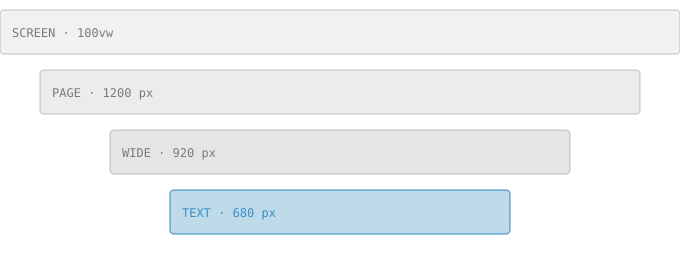

import './tour.css';
import momentumFallback from './figures/momentum.svg';
import MomentumExplorer from './figures/MomentumExplorer.astro';

Elucidate is built for articles that explain something carefully, in the spirit of the Distill
journal [@goh2017]. An article is a folder with an `index.mdx` file, written in Markdown with
components where you need them. Everything around the text, from the byline to the appendix, comes
from the front matter and the text itself.[^folder]

[^folder]: The example on this page lives in `src/articles/a-tour-of-elucidate/`. Copy it to start.

## Writing an article

Each article lives in its own folder under `src/articles/`. The folder name becomes the URL, so this
article is at `/research/a-tour-of-elucidate/`. Put images, data and components for the article next
to it:

```text
src/articles/a-tour-of-elucidate/
├── index.mdx      the article
├── Hero.astro     the title visualization (optional)
└── figures/       images and data
```

### Front matter

The block at the top of `index.mdx` holds the article's metadata. Only `title`, `description`,
`date` and `authors` are required:

```yaml
title: "A Tour of Elucidate"
description: "One sentence, used in the index and in search results."
date: 2026-11-11
status: published   # draft | review | published
authors:
  - name: Ada Lovelace
    orcid: 0000-0002-1825-0097
    affiliations: [cam]
affiliations:
  cam: { name: University of Cambridge }
```

Mistakes are reported with the file, the field and the expected form, so a typo like `autors` tells
you that you probably meant `authors`.

### Status

A `draft` is visible only on your development server. An article in `review` is built at its URL
for reviewers but not listed or indexed by search engines. Only `published` articles appear in the
index.

## Text and structure

Sections start with `##` and subsections with `###`. They are numbered in the table of contents,
which floats beside the text on wide screens and folds into a "Contents" button on phones.

Body text is set at 18 px with generous line spacing, about 68 characters per line. Links are
underlined and use the text color, like [this link to the Distill journal](https://distill.pub).
Inline `code` sits on a light surface.

### Lists and quotes

- Bulleted lists for things without an order.
- Numbered lists for steps.
- Both can contain **strong** and *emphasized* text.

> Quotes are set with a hairline on the left and muted text, without a background.

### Tables

A Markdown table inside a `Figure` with `kind="table"` gets a number and a caption above it.
@tbl:widths lists the widths that figures and heroes can use. Its caption holds code and a
cross-reference, so it is written as a `slot="caption"` child instead of the `caption` attribute.

<Figure id="tbl:widths" kind="table">
  <Fragment slot="caption">Column widths, set with `width`. @fig:widths draws them to scale.</Fragment>

| Width    | Column             | Use                                  |
| -------- | ------------------ | ------------------------------------ |
| `text`   | 680 px             | Body text, the default for figures   |
| `wide`   | 920 px             | Figures that need a little more room |
| `page`   | 1200 px            | Large figures and heroes             |
| `screen` | 100% of the window | Full-bleed visuals                   |

</Figure>

### Code

Code blocks use a monospace font and grayscale highlighting: tone and weight instead of hue.

```ts
// Gradient descent on f(w) = ½ wᵀAw
function step(w: number[], grad: number[], alpha = 0.1): number[] {
  return w.map((wi, i) => wi - alpha * grad[i]);
}
```

## Math

Write inline math between single dollar signs, like $\alpha_t$ or $w \in \R^n$, and display math
between double dollar signs. A `\label{eq:…}` numbers an equation so you can refer to it:

$$
w^{k+1} = w^k - \alpha \nabla f(w^k) \label{eq:gd}
$$

@eq:gd is plain gradient descent. Momentum adds a memory of past steps [@polyak1964; @sutskever2013]:

$$
z^{k+1} = \beta z^k + \nabla f(w^k), \qquad w^{k+1} = w^k - \alpha z^{k+1} \label{eq:momentum}
$$

Equations without a label, like $\norm{w}^2 = \sum_i w_i^2$, are not numbered. Math renders at
build time with KaTeX, or with MathJax if you set `math.engine: 'mathjax'`; macros such as `\R` and
`\norm` are defined once in `elucidate.config.ts`.

## Figures

Wrap an image or a component in `Figure` to give it a number, a caption and, for screen readers and
anyone who wants it, a longer description. @fig:widths shows the four widths:

<Figure
  id="fig:widths"
  width="wide"
  caption="The four column widths, from the full window down to the text column."
  description="Four nested bars. The widest is labeled screen, 100vw; then page, 1200 px; wide, 920 px; and text, 680 px, highlighted in blue."
>
  
</Figure>

Content defaults to the text column. Set `width` to `wide`, `page` or `screen` for more room, or
`margin` to place a small figure beside the text on wide screens. Cross-references such as
@fig:widths, @tbl:widths, @eq:momentum and @sec:math become links with the right number.

### Interactive figures

A figure can hold any component. @fig:momentum is an Astro component with a `<script>` in plain
TypeScript, so it needs no framework: drag the slider, pick a step size, and hover over a step or
focus the plot and use the arrow keys.

<Figure
  id="fig:momentum"
  width="wide"
  caption="Gradient descent with and without momentum on a long, narrow valley."
  description="Contour lines of an elongated bowl with its minimum on the right. Two paths start at the far left. Without momentum, the path creeps along the valley floor in small steps. With momentum, it travels much further per step, overshoots the minimum slightly and settles there in far fewer steps. Below the plot, a sentence gives the number of steps each method needs."
  fallback={momentumFallback}
>
  <MomentumExplorer name="momentum" />
</Figure>

Its colors come from the data palette, eight colors chosen to stay apart for readers with color
vision deficiencies, with separate versions for light and dark mode. Read them in a script, and
redraw when the reader switches themes:

```ts
import { onThemeChange, palette } from 'astro-elucidate/palette';

// colors.categorical[0], colors.sequential(0.5), colors.grid, …
let colors = palette();
onThemeChange(() => {
  colors = palette();
  draw();
});
```

In CSS, use the tokens `--el-data-1` to `--el-data-8` directly. The `description` is read by screen
readers and shown behind the "Description" button; the `fallback` image replaces the figure in
print and when JavaScript is off. The sliders, segmented buttons and switch are styled by the
classes `el-slider`, `el-segmented` and `el-toggle`.

### Overlays

Some tools need the whole window. An `Overlay` opens as a dialog, a drawer or, like this one, over
the full window. Its `id` becomes the URL: [a link to `#explorer`](#explorer) opens it as well,
so a view can be shared.

<Overlay id="explorer" title="Momentum explorer" size="full" trigger="Open the explorer">
  <MomentumExplorer name="explorer" size="large" />
</Overlay>

Inside it, the tooltip of each step is a popover, so it floats above the overlay without any
`z-index`. Esc or the close button closes the overlay and returns focus to the button.

## Asides, notes and wide content

<Aside>An aside like this one sits in the right margin on wide screens and inline on narrow ones.</Aside>

`Aside` holds a remark beside the text, without a number. Put it just before the paragraph it
belongs to. `Note` sets a short passage apart in the column itself:

<Note label="Note">
  Momentum helps most on ill-conditioned problems, where some directions are much steeper than
  others.
</Note>

`Block` puts any content at a wider width, like this row of the eight data colors at page width:

<Block width="page">
  <div class="tour-swatches">
    <span style="--c: var(--el-data-1)">1</span>
    <span style="--c: var(--el-data-2)">2</span>
    <span style="--c: var(--el-data-3)">3</span>
    <span style="--c: var(--el-data-4)">4</span>
    <span style="--c: var(--el-data-5)">5</span>
    <span style="--c: var(--el-data-6)">6</span>
    <span style="--c: var(--el-data-7)">7</span>
    <span style="--c: var(--el-data-8)">8</span>
  </div>
</Block>

### Your own components

Components exported from `src/components/index.ts` work in every article without an import, like
this one from the starter:

<Definition term="Momentum">
  An update that adds a fraction β of the previous step to the current gradient step, so that
  steps in a consistent direction build up speed.
</Definition>

During development, `/components/` shows every built-in component and every one of yours, each
with an example and its source.

## Citations and footnotes

Cite with the key from the article's `.bib` file in square brackets, one or several at once
[@kingma2014]. Citations are numbered in order of first use; hover over or focus a number to see the
reference, and follow it to the bibliography at the end.

Footnotes use the usual Markdown syntax.[^1] On wide screens they appear beside the text; on
narrower ones they open like citations. Both are listed again in the appendix, together with the
material in @sec:derivations.

[^1]: Like this one. Footnotes can contain *formatting*, links to [Distill](https://distill.pub) and
    math such as $\beta = 0.9$.

## The hero

The visual under the title is `Hero.astro` from this article's folder. It can be any Astro
component: this one computes a gradient-descent path at build time and draws it as SVG, so it ships
no JavaScript. An image named `hero.png` (or `.svg`, `.jpg`, `.webp`, `.avif`) works too; give it
alt text with `hero: { alt: "…" }`.

Set `hero.width` to `wide`, `page` or `screen`, and `hero.position` to `above` to show the visual
before the title.

<Acknowledgments>
  We thank the Distill authors, whose articles showed what a scholarly page on the web can be.
</Acknowledgments>

<Contributions>
  A.L. wrote the article; C.B. drew the figures.
</Contributions>

<AppendixSection title="A. Derivations" id="sec:derivations">
  Unrolling @eq:momentum shows that momentum averages past gradients with geometrically decaying
  weights:

  $$
  z^{k+1} = \sum_{i=0}^{k} \beta^{i} \nabla f(w^{k-i})
  $$
</AppendixSection>
