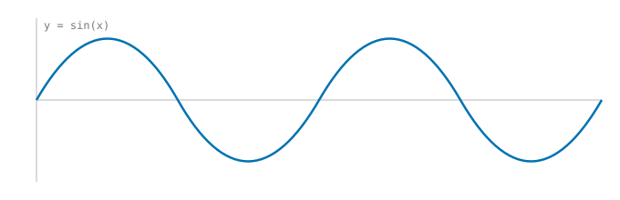

This is a minimal article. To start a new one, copy this folder or run `npm run new` with a title.
Explaining ideas clearly pays off for everyone who reads them [@olah2017].

<Figure id="fig:wave" caption="A sine wave, stored in the article's figures folder.">
  
</Figure>

@fig:wave is a Markdown image inside a `Figure`, which gives it a number and a caption. The
reference above comes from `references.bib` next to this file.
